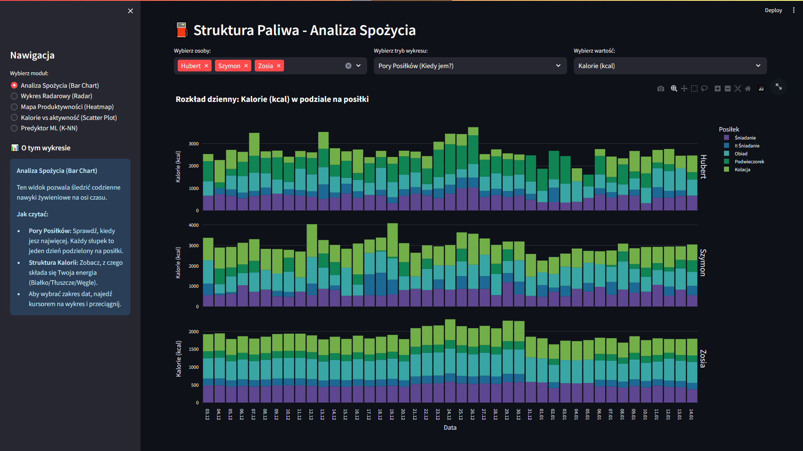
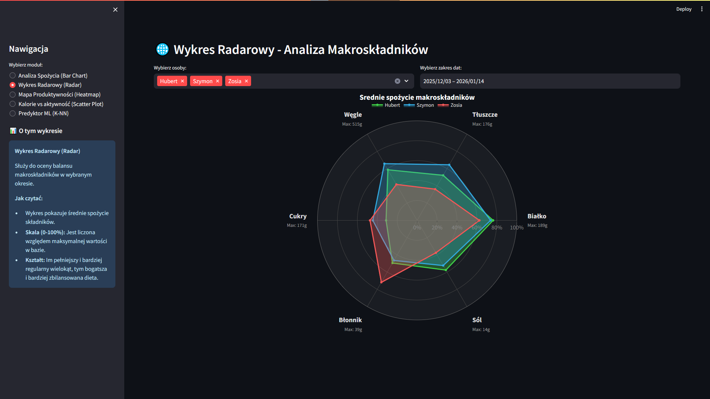
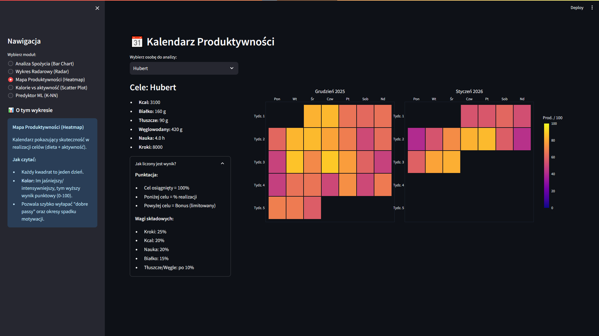
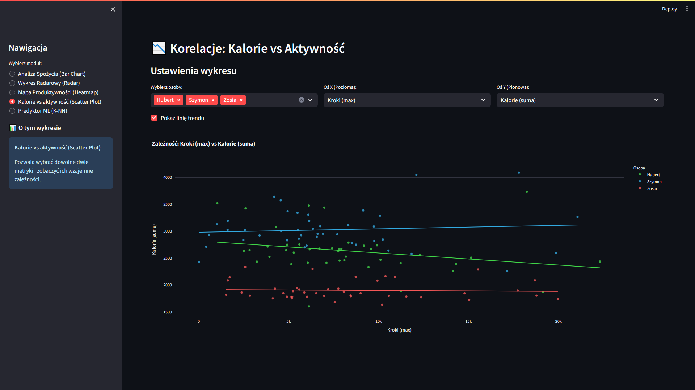
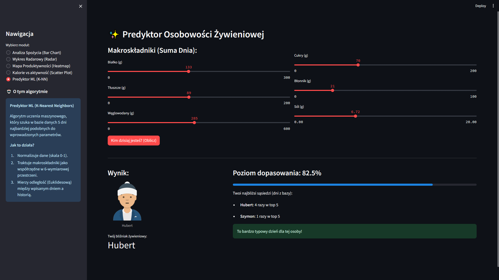

# Interactive Lifestyle & Nutrition Analytics Dashboard

An interactive data visualization and machine learning web application built with **Streamlit** and **Plotly** to track, correlate, and analyze multivariate personal health, nutrition, and productivity metrics.

> **Academic Project:** Developed as part of the *Data Visualization Techniques* coursework at **Warsaw University of Technology**, Faculty of Mathematics and Information Science (MiNI), in collaboration with Hubert Zalewski and Szymon Domański.

---

## Project Overview
Over a 1.5-month tracking period, our team collected granular daily data on nutritional intake (macronutrients, calories), physical activity (steps), and academic productivity (study hours). 

This platform allows users to explore behavioral correlations, compare dietary profiles, and leverage machine learning to personalize habit tracking.

---

## Key Modules & Analytical Views

### 1. Fuel Structure (Stacked Bar Charts)
Analyzes daily calorie and macronutrient distributions across meals (breakfast, lunch, snacks, dinner) to evaluate energy allocation throughout the day.

  

### 2. Macronutrient Profiling (Radar Charts)
Compares average nutrient intake (protein, fats, carbohydrates, sugars, fiber, sodium) between individuals using multidimensional radar charts.

  

### 3. Cross-Feature Correlation Analysis (Interactive Scatter Plots)
Investigates dependencies between lifestyle factors (e.g., impact of daily step count on caloric intake, correlation between sugar consumption and focused study hours).

  

### 4. Weighted Productivity Calendar
Evaluates and visualizes daily goal completion (steps, calorie targets, study time, protein intake) through a custom weighted scoring algorithm rendered on an interactive calendar heatmap.

  

### 5. "Nutrition Twin" (K-Nearest Neighbors Recommendation)
Utilizes **K-Nearest Neighbors (KNN)** to find historical days with the most similar nutritional profile to a user's current daily input across multidimensional feature space.

  

---

## Tech Stack
- **Language:** Python
- **Dashboard Framework:** Streamlit
- **Visualization:** Plotly, Matplotlib
- **Machine Learning & Data Processing:** scikit-learn (KNN), Pandas, NumPy
